# VOXYN

**Real-time voice, shared rooms, and mini-games in one workspace.**

VOXYN is a full-stack social platform prototype built with Vue 3, Express, Socket.IO, WebRTC, and Supabase. Users can create a room, invite friends, talk, exchange messages, and launch games without leaving the room experience.

**Current milestone:** v1.1 · **Stage:** Active development · **Author:** [Ze Yu Shi](https://github.com/Zeyu-lab)

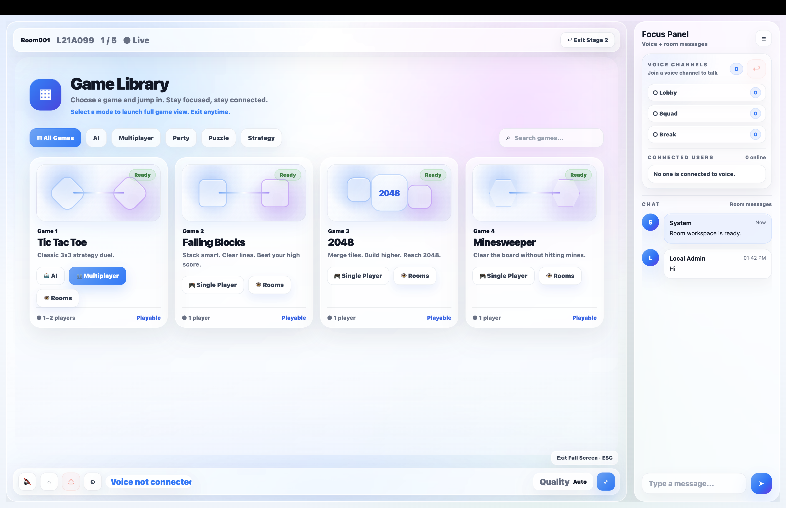

*Game Focus Mode keeps the game library, voice channels, and room chat together.*

[Overview](#overview) · [Product tour](#product-tour) · [Features](#features) · [Architecture](#architecture)

[Development journey](#development-journey) · [Version milestones](#version-milestones) · [Engineering decisions](#engineering-decisions)

[Local development](#local-development) · [Verification](#verification) · [Status and roadmap](#status-and-roadmap)

## Overview

VOXYN explores how authentication, room presence, voice communication, and interactive games can work as one connected application. The room is the central unit: it holds the participants, voice channels, messages, and game sessions.

The main user flow is:

**Create an account → Open the dashboard → Create or join a room → Join voice → Play or watch a game.**

The interface has two complementary views:

- **Room Workspace:** room information, invitations, members, voice controls, chat, and the game entry point.
- **Game Focus Mode:** a larger game area alongside a voice and chat panel, with room controls still available.

The current application runs a local Node.js backend with managed Supabase services. A fully self-hosted database and deployment stack are planned for a later version.

### What's new in v1.1

- Stabilized login and room creation / joining across regular accounts and local development accounts.
- Added Minesweeper with three difficulties, backend-owned game rules, and live spectator updates.
- Added Minesweeper player-slot handover and session rejoining.
- Reduced the game library to four implemented games, removing unused preview entries.
- Added Minesweeper rule tests and expanded integration checks.

## Product tour

The screenshots below follow the main product areas. Expand a section to view its screens.

<details>
<summary><strong>Dashboard — create a room and invite friends</strong></summary>

The dashboard brings together room actions, account access, invitations, and platform status panels.

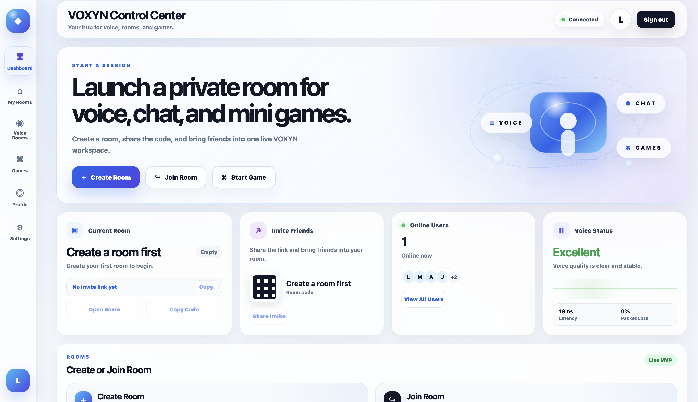

</details>

<details>
<summary><strong>Room Workspace — voice, presence, and chat</strong></summary>

Room information, member presence, voice channels, and chat share the same workspace.

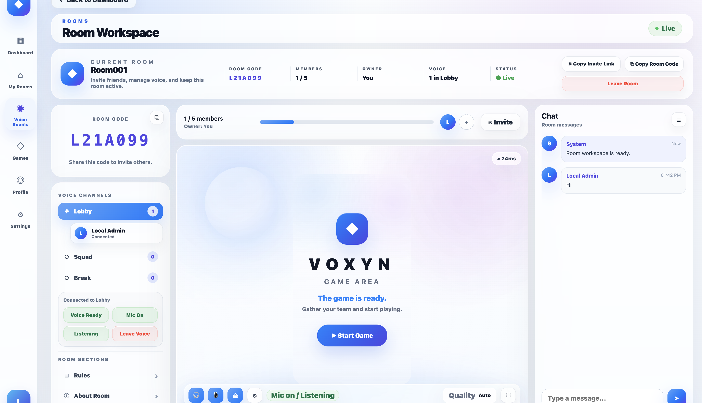

*Voice channels and connection controls within the room.*

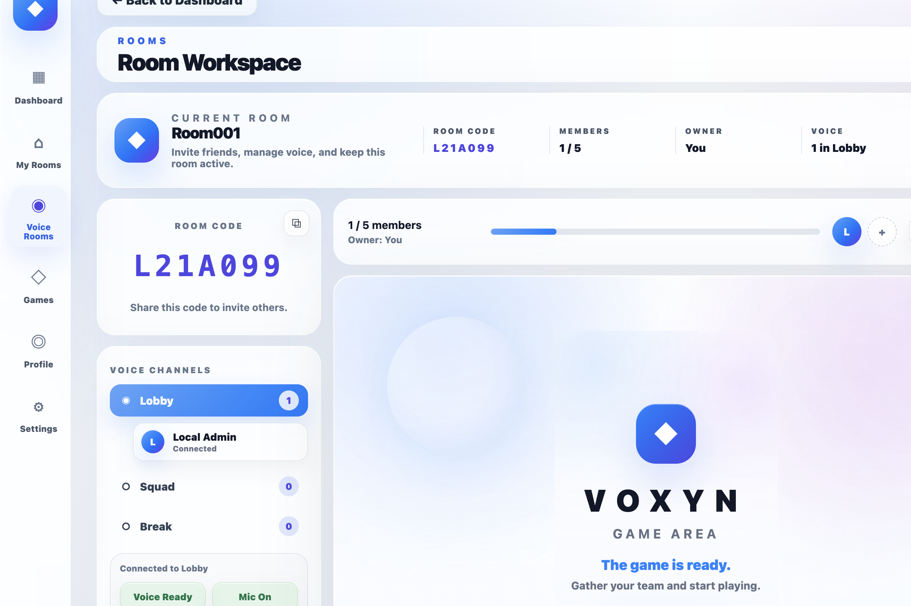

*Room identity, invitations, and voice presence.*

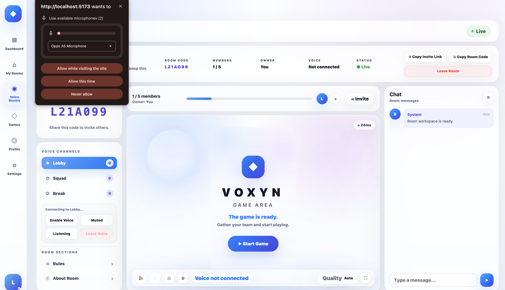

*The browser requests microphone access before voice can start.*

</details>

<details>
<summary><strong>Games — Minesweeper, 2048, and room discovery</strong></summary>

Games run inside the room rather than on separate standalone pages.

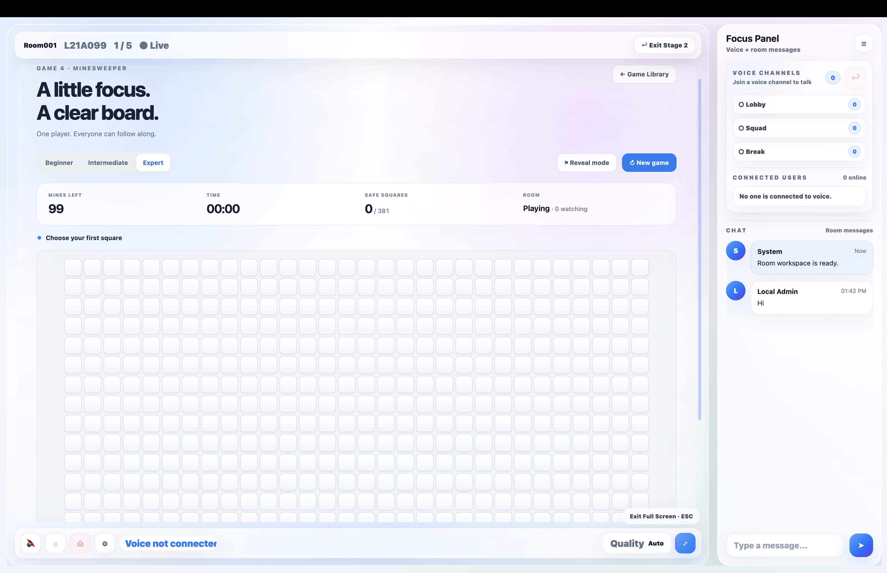

*Minesweeper: an Expert board, difficulty selection, flag mode, and round counters.*

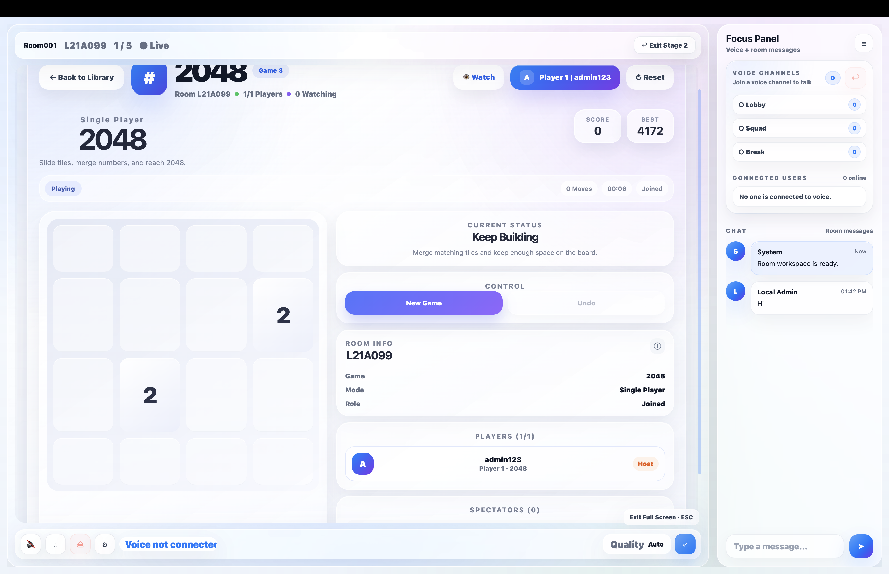

*2048: gameplay, player identity, and session information.*

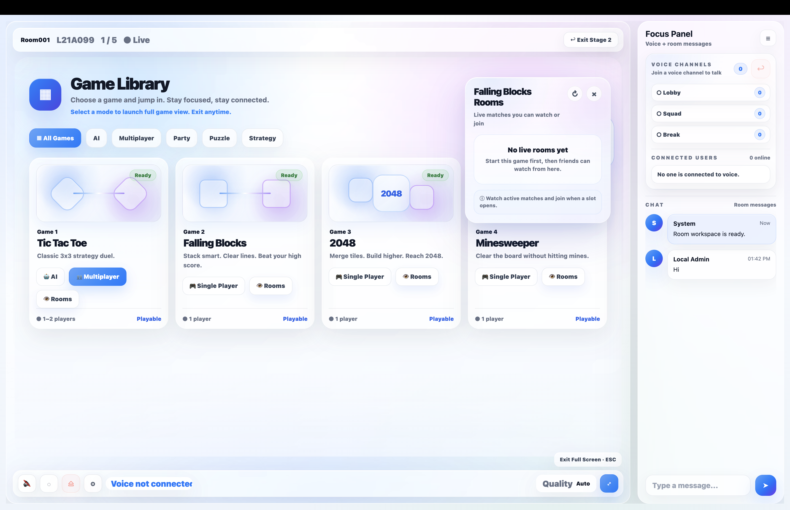

*The per-game Rooms drawer provides an entry point for finding sessions to watch or join.*

</details>

<details>
<summary><strong>Authentication — login, account creation, and verification</strong></summary>

The account flow combines email/password login with custom email-code registration.

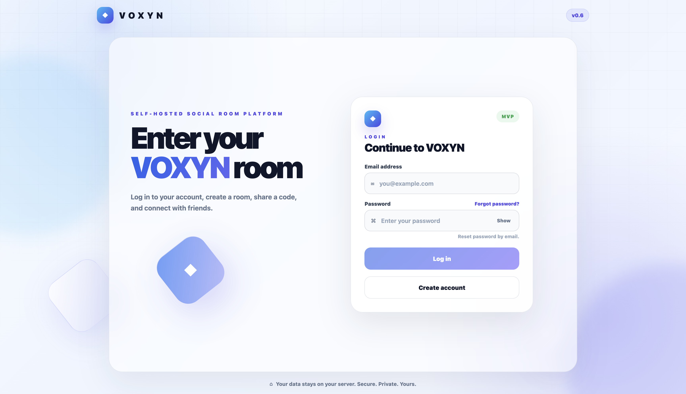

*Login and password recovery entry points.*

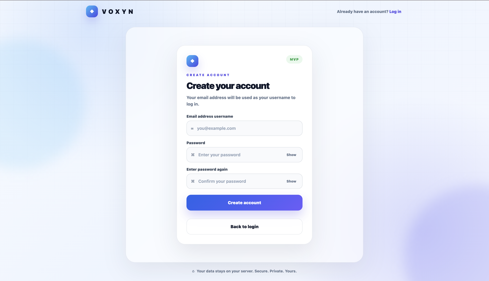

*Account creation with password confirmation.*

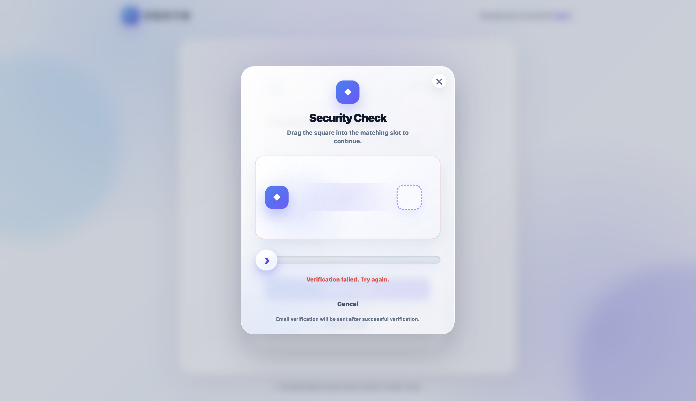

*The slider verification step, including feedback for an unsuccessful attempt.*

</details>

<details>
<summary><strong>Profile — account identity and preferences</strong></summary>

The profile page provides account information, display-name and status settings, and avatar controls.

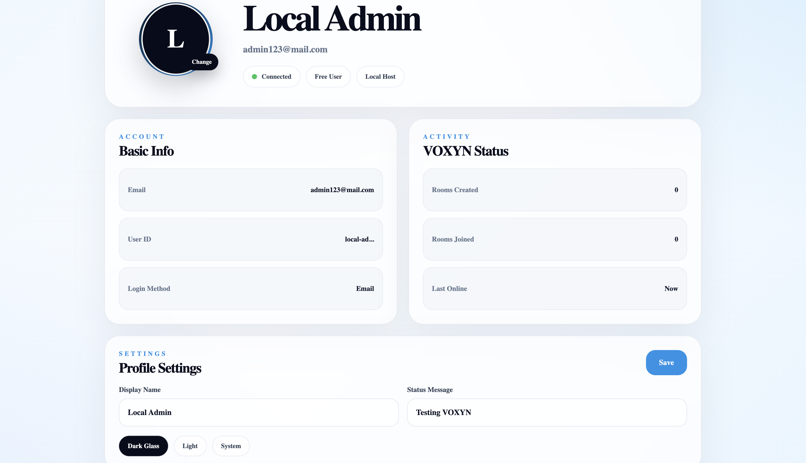

</details>

*Screenshots show the development interface. UI labels and status panels are not performance benchmarks; some displayed version labels predate the v1.1 milestone.*

## Features

### Authentication and account creation

VOXYN combines Supabase-backed accounts with a custom registration workflow managed by Express. The frontend collects account details and presents the verification screens; the backend generates and validates the signup code before creating the account through the Supabase admin flow.

The normal registration sequence is:

1. Enter an email address and confirm a password.
2. Complete the slider interaction in the Security Check modal.
3. Request a six-digit verification code from the backend.
4. Receive the code through SMTP and enter it on the verification screen.
5. Complete code verification and account creation, then return to login.

The OTP implementation includes cryptographic code generation, a backend-held pepper for hashing, expiration, resend cooldown, attempt tracking, and consumed-code state. This makes the code lifecycle explicit: a code is created, stored as a hash, verified within its allowed window, and invalidated after use or expiration. SMTP delivery uses Nodemailer; Gmail App Password delivery was confirmed during development after earlier provider configuration problems.

Existing users can log in with email and password. Password recovery uses the Supabase reset-email flow and a dedicated password-update page. The slider adds an interaction step before the frontend sends an OTP request; it is not a replacement for backend rate limiting or a production abuse-prevention system.

A separate local development-account path supports controlled testing alongside normal accounts. It is optional, gated by development settings, and requires private local configuration. The v1.1 stabilization work addressed differences between those account paths when creating and entering rooms.

### Profiles and shared identity

Profiles provide the identity used across the dashboard, room members, chat messages, and voice participants. The profile workflow supports a display name, avatar, and status message, while account information remains available on the profile page.

For Supabase-backed accounts, avatar files use Supabase Storage and profile metadata records the avatar location and update timestamp. Earlier iterations added old-avatar replacement, a fallback initial when an image cannot load, and cache-busting to avoid showing a previous avatar after an upload. Metadata keys were also standardized so each page could read the same identity fields.

This work connected more than the profile screen. An updated name or avatar needed to remain recognizable when the same user appeared in the dashboard, entered a room, sent a message, or joined voice. The developer diary records this synchronization as a separate milestone rather than treating profile styling alone as a completed user system.

### Dashboard and room lifecycle

The dashboard is the entry point after authentication. It groups room creation and joining, invitation access, profile navigation, and status panels. The current visual design uses a compact navigation rail and light glass panels that carry through to the room experience.

Rooms use a shared room code under one backend. Creating a room does not start a separate server process; users join a room identity that the application uses to coordinate membership, voice, messages, and game sessions.

The room workflow includes:

- Creating a room with a name and member limit.
- Joining an existing room by code.
- Displaying the owner, member count, room code, and current room state.
- Copying an invitation link or room code.
- Entering the Room Workspace and opening Game Focus Mode.
- Leaving the room and cleaning up the associated realtime participation.

The v1.1 checkpoint includes repaired login, room-creation, and room-entry flows for local test accounts and normal email-based accounts. Room requests use the room-service layer rather than duplicating the same HTTP logic in every page.

### Realtime chat and presence

Socket.IO coordinates room participants and messages while the room is active. Joining, leaving, and disconnecting update the room's online state, and recent messages are kept in a bounded in-memory history for the active room.

The chat interface remains available in the Room Workspace and the Game Focus Mode side panel. This lets conversation continue while a user opens the library, starts a game, or watches another participant. Usernames, avatar images, and fallback initials connect these realtime messages to the profile identity.

Room membership and realtime presence have different lifecycles. A database record can describe a room or its members, while the active socket store describes who is currently connected. The current implementation keeps realtime presence, recent messages, and game sessions in memory; they are not durable chat archives or persistent game saves.

### Voice channels and controls

Voice communication uses WebRTC for audio and Socket.IO for signaling. The signaling channel exchanges offers, answers, and ICE candidates so participants can establish their audio connections.

The room exposes three fixed voice channels: **Lobby**, **Squad**, and **Break**. Participants can enable microphone access, join a channel, mute their microphone, deafen incoming playback, and leave voice without leaving room chat. Voice presence shows channel membership and a speaking indicator.

Speaking detection reads the local microphone's audio energy to drive interface feedback, such as an avatar ring. That feedback is separate from the WebRTC audio connection: a visible speaking state alone does not establish that another participant is receiving clear sound.

Leaving voice cleans up the local microphone and peer connections and removes the participant from the channel list. Entering Game Focus Mode is intended to preserve room communication, with microphone, listening, and leave controls still accessible from the game view.

HTTPS testing through Cloudflare Quick Tunnel enabled remote microphone testing and two-user audio checks during development. Voice transmission has been demonstrated, while delayed speech and electronic / distorted audio remain open issues. The current configuration uses STUN without a TURN fallback, so network traversal and audio quality remain separate areas for validation.

### Game library and focus mode

The game system is component-based. `GameLibrary.vue` provides the catalog, `GameCard.vue` presents entries, and `GameStage.vue` selects the game component and coordinates its session context. Individual game rules and interfaces stay outside the large room-page component.

The library supports full cards on larger screens and a compact launcher layout in narrower views. Game Focus Mode combines the selected game with a side panel for voice channels, connected users, and room chat. Previous layout iterations addressed internal scrolling, narrow-window behavior, and voice controls covering the cards.

| Game | Play model | Current capabilities |
| --- | --- | --- |
| **Tic Tac Toe** | AI or multiplayer | Turn-based play, player roles, spectator controls, and room-level session information |
| **Falling Blocks** | One runner with watchers | 10 × 15 board; Casual / Standard / Fast / Chaos difficulties; score, lines, level, survival time, and start / pause / restart controls |
| **2048** | One player with viewers | Tile merging, score and best-score display, room information, and player / spectator interface |
| **Minesweeper** | One player with live spectators | Three difficulties, safe first reveal, backend-owned rules, synchronized snapshots, and player handover |

The **Rooms** entry on a game card opens a drawer for discovering active sessions. Depending on the session, a user can watch or take an open player position. The shared session model contains player slots, spectator identities, room context, and game state, but the authority and synchronization model varies by game.

### Minesweeper in v1.1

Minesweeper extends the existing platform with a game whose rules run on the backend. The frontend renders the visible board and submits player actions. It does not decide where mines are placed or submit an arbitrary replacement board.

| Difficulty | Board | Mines | Safe squares |
| --- | --- | --- | --- |
| Beginner | 9 × 9 | 10 | 71 |
| Intermediate | 16 × 16 | 40 | 216 |
| Expert | 16 × 30 | 99 | 381 |

**Rules and controls**

- The first reveal generates the minefield while protecting the selected square and its neighbors.
- Clicking reveals a square; empty regions expand automatically.
- Right-clicking or pressing **F** on a focused square toggles a flag. Touch users can select **Flag mode**.
- Arrow keys move focus across the board. Enter or Space uses the selected interaction mode.
- Clicking an open number expands neighboring squares when the surrounding flag count matches the number. Incorrect flags can still trigger a mine.
- Revealing every safe square wins the round. Hitting a mine ends it and reveals the end-state information.
- The timer starts with the first reveal and stops when the round ends. Mine and safe-square counters show progress.
- Restarting or changing difficulty creates a fresh round. Wide boards scroll horizontally in a narrow viewport.

**Session behavior**

Each room has one active Minesweeper player position. Additional participants become spectators and receive the current visible board followed by live updates. Reveal, flag, difficulty, and restart actions are restricted to the player.

Returning to the library releases the player position. When spectators remain in the session, a waiting viewer can select **Take player seat** and continue that board. **Rejoin game** requests the current session after a connection interruption; it does not automatically create a new round.

The backend checks membership, player-slot ownership, round ID, and board revision before applying an action. Stale requests cannot silently overwrite a newer round. During active play, public snapshots omit unopened mine positions and adjacent counts. The generic client board-sync endpoint rejects Minesweeper snapshots so this validation path remains the source of game state.

### UI and interaction design

The visual direction evolved toward a white, frosted-glass interface with soft blue accents, restrained gradients, rounded panels, consistent spacing, and a clear hierarchy between page actions and supporting information.

The design work spans login, signup, the verification modal, dashboard, profile, Room Workspace, Game Library, and GameStage. Responsive work focused on preserving usable game width, handling long content, and keeping voice and chat accessible when the viewport changes. Advanced motion and further mobile polish remain later work.

## Architecture

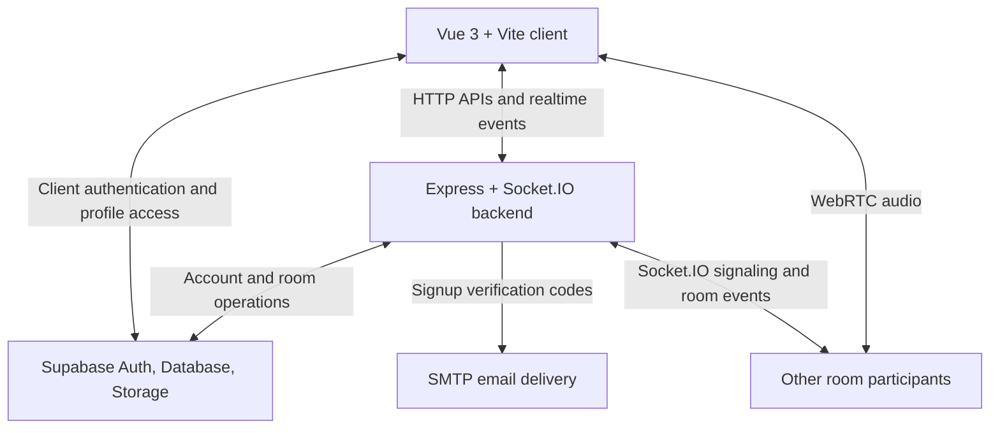

### Responsibilities

| Layer | Responsibility |
| --- | --- |
| Vue client | Pages, profile controls, room workspace, game rendering, and user input |
| Express APIs | OTP registration, authenticated room operations, and local development-account integration |
| Socket.IO | Presence, messages, game sessions, state updates, and WebRTC offer / answer / ICE signaling |
| WebRTC | Audio transport between participants |
| Supabase | Authentication, application database records, profile metadata, and avatar storage |
| SMTP | Delivery of signup verification codes |

For Minesweeper, the client submits actions rather than a replacement board. The backend checks room membership, player-slot ownership, round identity, and board revision before applying a move. Unopened mine positions and their neighbor counts stay on the backend during active play.

Room presence, recent chat history, and game sessions use the backend's in-memory realtime store. These transient states are cleared when the backend restarts. Supabase-backed account and room records have a separate persistence lifecycle.

### Request, event, and state boundaries

The platform uses HTTP requests for account and room operations, Socket.IO events for active shared state, and WebRTC for audio. These transports have different responsibilities even when they are exposed through the same development origin.

| Interface | Role in the application |
| --- | --- |
| `/api/auth/signup/request-code` | Generate and deliver a signup verification code |
| `/api/auth/signup/verify` | Verify the code and complete account creation |
| `/api/player/rooms` | Authenticated room listing and creation |
| `/api/player/rooms/:code` and related routes | Room lookup, membership operations, and owner-controlled removal |
| `voice:join` / `voice:leave` | Update active voice-channel participation |
| `voice:offer` / `voice:answer` / `voice:ice-candidate` | Relay WebRTC signaling between participants |
| `game:join-session` / `game:leave-session` | Enter and leave a game session |
| `game:session-update` / `game:state-update` | Deliver shared session and game-state updates |
| `game:minesweeper-action` | Apply validated Minesweeper input on the backend |

Earlier games use the shared game-state synchronization model. Minesweeper adds a separate backend-owned rule model while retaining the existing session broadcasts. This allows the room and spectator interface to be reused without presenting every game as if it had identical authority or validation.

| State category | Current location | Lifecycle |
| --- | --- | --- |
| Accounts and profile metadata | Supabase Auth | Managed account state |
| Application room and membership records | Supabase Database | Database-backed records |
| Avatar files | Supabase Storage for regular accounts | Stored separately from profile references |
| Connected participants and recent chat | Backend memory | Cleared when the process restarts |
| Active game sessions and Minesweeper boards | Backend memory | Retained while the session exists; cleared on restart |
| Optional local test-account state | Private local development files | Separate from the regular account path |

The optional local account path exists to support development, including room and profile testing. It does not make the application independent of Supabase or replace the managed-account architecture.

### Code organization

| Path | Purpose |
| --- | --- |
| `frontend/src/pages/` | Login, signup, dashboard, profile, and room pages |
| `frontend/src/components/games/` | Game Library, GameStage, game cards, and individual game components |
| `frontend/src/services/` | Room-service requests and local authentication integration |
| `frontend/src/lib/supabaseClient.js` | Shared Supabase client and Socket.IO connection |
| `frontend/src/webrtc/` | Voice configuration and peer-connection lifecycle |
| `backend/server.js` | Express bootstrap, OTP endpoints, and realtime event handling |
| `backend/localPlayer.js` | Authenticated player / room operations and local test-account support |
| `backend/minesweeper.js` | Minesweeper rules, public snapshots, and action handling |
| `tests/minesweeper.test.cjs` | Minesweeper rule regression tests |
| `docs/images/` | Product screenshots referenced by this README |

### Technology stack

| Area | Technologies |
| --- | --- |
| Frontend | Vue 3, Vue Router, Vite, JavaScript, CSS |
| Backend | Node.js, Express, Socket.IO, Node crypto |
| Voice | WebRTC, browser MediaDevices / Web Audio APIs |
| Authentication and storage | Supabase Auth, Database, Storage |
| Email | Nodemailer, SMTP |
| Development and verification | Node test runner, Vite builds, Cloudflare Quick Tunnel |

## Development journey

The developer diary records VOXYN as a sequence of connected milestones. Each stage introduced a capability and then exposed integration problems that shaped the next stage. The history below preserves that progression while separating historical experiments from the current v1.1 feature set.

### 1. Dashboard and profile foundation — v0.3 to v0.311

Early work established a usable dashboard: a full-height sidebar, create / join panels, configurable member limits, recent-room areas, and consistent navigation. This provided the first practical entry point for the room concept.

The profile prototype then added a dedicated route, a dashboard profile button, avatar uploads, Supabase Storage policies, and profile metadata. Follow-up work replaced old avatar objects instead of accumulating unused uploads. This stage introduced the need to manage both a stored file and the metadata that references it.

### 2. Realtime rooms and identity consistency — v0.4 to v0.46

Adding Socket.IO changed the backend from a set of HTTP endpoints into a coordinator for active rooms. The diary records room joining, leaving, disconnection cleanup, online participants, chat messages, and recent-message history during this phase.

Navigation and responsive work followed in v0.41 and v0.45. The dashboard rail, room navigation, and mobile menu needed consistent behavior rather than separate implementations that looked similar but responded differently.

Version v0.46 concentrated on identity consistency. Display names, status messages, avatar fields, fallback initials, and avatar update timestamps were standardized. The practical goal was to ensure the same user appeared consistently across profile, dashboard, rooms, and realtime messages.

### 3. Voice presence before audio transport — v0.51

The first voice milestone displayed users in fixed channels and synchronized microphone, listening, and speaking states between accounts. Avatars, channel counts, and speaking indicators established the interface before real audio transport was considered complete.

This distinction mattered during testing. Seeing a speaking ring on another account demonstrated that state updates were reaching the room, but actual microphone capture, peer connections, and remote playback still required a separate implementation and validation step.

### 4. WebRTC, HTTPS, and voice lifecycle — v0.52 to v0.53

Version v0.52 connected WebRTC offer / answer / ICE signaling through Socket.IO and introduced remote audio stream handling. Building the Vite frontend and serving it through Express enabled a shared HTTPS origin behind Cloudflare Quick Tunnel. Same-origin socket connections replaced assumptions that every tester could reach the developer's localhost address.

The diary records two-user voice transmission through HTTPS and successful microphone permission handling. It also records electronic tail noise, echo, or robotic audio as a remaining quality problem. Establishing audio transmission was therefore a milestone with a known follow-up issue, not a claim of finished voice quality.

Version v0.53 separated leaving voice from leaving the room. Cleanup needed to stop the microphone, close voice connections, clear channel membership, and update local UI immediately while preserving chat access. A null voice channel also needed to remain null rather than falling back to Lobby and showing a user who had already left.

### 5. Authentication pages and Game Focus Mode — v0.6 to v0.72

Authentication UI work added a dedicated signup page, password confirmation, account verification states, forgot-password behavior, and a password-update route. Login and landing-page navigation were revised to connect those pages into a coherent account flow.

The room layout then expanded into Game Focus Mode. A larger game area was paired with a Focus Panel containing voice channels, users, and chat. Bottom voice controls remained available while users entered or exited the game-focused view.

Versions v0.71 and v0.72 introduced the component-based game launcher and addressed its layout behavior. Full desktop cards and compact launch rows were separated, narrow windows received dedicated handling, and the bottom voice bar was moved into the layout so it would not cover game cards. These changes made the game system usable within the room instead of simply placing an independent game on a page.

### 6. Falling Blocks and the shared session model — v0.73 to v0.75

Falling Blocks added the arcade direction: a 10 × 15 board, four speed presets, score / line / level tracking, a survival timer, and start / pause / restart controls.

The next milestone introduced backend game configurations and a common player / spectator session model. Falling Blocks used player-authoritative state updates for watchers, and the interface gained player counts, spectator counts, and player-slot controls. This established the reusable session vocabulary that later work could extend.

### 7. Email OTP and external tester access — v0.8 to v0.801

The custom registration workflow moved OTP generation, hashing, storage, verification, and account creation into the backend. The diary records debugging SMTP delivery and replacing a blocked Brevo sending setup with Gmail SMTP App Password credentials that successfully delivered real verification emails.

This period also included an invitation-controlled Beta Access registration path for approved testers. It is part of the development history; the standard signup workflow described in this README remains email-code registration.

Version v0.801 addressed an important external-testing mismatch. A hardcoded localhost backend URL works only on the machine running that backend. Relative API requests, Vite proxies for `/api` and `/socket.io`, and a single Cloudflare frontend tunnel allowed external testers to use the application through one origin. This was an integration correction across deployment context, HTTP requests, and socket connections.

### 8. Slider verification and room discovery — v0.82 to v0.9

The slider challenge was added before requesting email codes. Iteration focused on target alignment, input responsiveness, retry behavior, and visual consistency with the white-glass authentication UI.

Game work then expanded beyond launching a component. The Rooms drawer introduced per-game session discovery, Watch and Join actions, and links into a target room and game. Tic Tac Toe gained explicit turn-based player roles and spectator restrictions. Falling Blocks adopted Runner / Watcher terminology and clearer session presentation.

These changes exposed the difference between displaying a spectator interface and maintaining synchronized gameplay. The project continued to treat those as distinct implementation and verification responsibilities.

### 9. First complete product checkpoint — v1.0

Version v1.0 defined the first complete product scope: authentication, profiles, dashboard, rooms, realtime messaging, voice integration, Game Library, GameStage, and three games—Tic Tac Toe, Falling Blocks, and 2048.

Minesweeper and additional games were deferred at that checkpoint. The purpose was to establish a usable platform flow and a consistent visual direction before continuing game expansion, deeper synchronization, or infrastructure migration. Production hardening and fully self-hosted deployment were not part of that first milestone.

### 10. Stabilization and backend-owned Minesweeper — v1.1

The October 13-14, 2026 work was consolidated into v1.1. Account and room-access issues were repaired across normal and local test accounts, and the game library was reduced to four implemented entries by removing Blackjack, Chess, Word Battle, and Party Quiz previews.

Minesweeper added a backend rules module, a frontend board component, and integration with the existing game-session channels. The implementation introduced safe first reveals, three difficulties, flags, expansion, round outcomes, counters, spectator snapshots, validated actions, and player handover.

Validation included the committed rule suite, an additional Socket.IO integration harness, Vue compilation, and backend syntax checks. Integration also exposed a local filename mismatch between the backend module and its import, which was corrected by keeping `minesweeper.js` and `require("./minesweeper")` consistent.

Voice review continued during the same checkpoint. Immediate teardown on a temporarily disconnected peer was identified as a stability issue and a targeted change was proposed. The development diary does not record a confirmed audio-quality fix, so delayed speech and distortion remain open items in the current status.

## Version milestones

This timeline follows the developer diary. Earlier Stage experiments and intermediate authentication work were consolidated into the broader milestones shown here.

| Version | Recorded milestone |
| --- | --- |
| **v0.3** | Dashboard rebuild, sidebar layout, create / join panels, member limits, and room-access sections |
| **v0.31** | Dedicated profile page, avatar uploads, storage policies, and dashboard identity display |
| **v0.311** | Old-avatar replacement to avoid retaining unused avatar files |
| **v0.4** | Socket.IO rooms, chat, presence, recent history, and leave / disconnect cleanup |
| **v0.41** | Rail-navigation and half / full-screen layout adjustments |
| **v0.45** | Consistent dashboard / room navigation and mobile-menu behavior |
| **v0.46** | Standardized profile metadata, fallback initials, and avatar cache-busting |
| **v0.51** | Voice-channel presence, speaking state, and microphone / listening controls |
| **v0.52** | WebRTC audio transmission, HTTPS testing, and same-origin production socket connections |
| **v0.53** | Leave Voice behavior and channel / microphone cleanup without leaving chat |
| **v0.6** | Login / signup redesign, password recovery, and account-flow routing |
| **v0.7** | Game Focus Mode, Focus Panel, and persistent room communication controls |
| **v0.71** | Component-based game launcher, Tic Tac Toe, and compact library layout |
| **v0.72** | Stage layout checkpoint, scrolling corrections, and integrated bottom voice bar |
| **v0.73** | Falling Blocks, difficulty presets, survival timer, and gameplay counters |
| **v0.75** | Shared game sessions, player / spectator roles, and Falling Blocks watcher synchronization |
| **v0.8** | Confirmed custom OTP registration, working SMTP delivery, and approved-tester access experiments |
| **v0.801** | External tester registration through relative API paths, Vite proxies, and one HTTPS tunnel |
| **v0.82** | Slider verification workflow and responsive challenge interaction |
| **v0.9** | Per-game Rooms drawer, session discovery, role-based gameplay, and watcher presentation |
| **v1.0** | First complete product checkpoint with the main platform flow and three-game scope |
| **v1.1** | Account / room fixes, four-game catalog, backend-owned Minesweeper, live spectators, and regression checks |

## Engineering decisions

### Keep the room as the product boundary

The room provides the common context for identity, voice, chat, and games. A user should not need to reconstruct that context every time a game opens. Room codes, shared participant state, and the two workspace views support this continuity.

This also creates integration work: entering a game should preserve chat and voice, leaving a voice channel should not remove room membership, and leaving a game should release the game slot without necessarily ending the room session.

### Separate signaling, audio, and game state

Socket.IO provides a coordination channel for rooms, messages, and game sessions. For voice, it relays signaling information; WebRTC carries audio. Treating these responsibilities separately makes it possible to distinguish a socket or presence problem from a media connection or playback problem.

Game state has another boundary. The room backend can coordinate a player and viewers while a game uses client-originated snapshots, or it can evaluate actions against backend-owned rules. Minesweeper implements the latter model without implying that every earlier game has been rewritten.

### Componentize games and service access

The game launcher, card presentation, stage rendering, and individual games live in separate components. Room requests use a service layer, and WebRTC logic is isolated from the room's presentation code.

This direction limits repeated integration logic and helps keep large page components from owning every subsystem. The project still has a substantial backend entry file and room page, so further modularization remains part of the maintenance work rather than a completed architectural claim.

### Use Supabase now while planning infrastructure migration

Supabase provides managed authentication, database access, and storage while the project concentrates on product behavior and realtime integration. A custom signup API still allows the application to control OTP delivery and verification before creating an account.

A future MySQL and Docker direction is a separate migration. It requires decisions about account handling, data persistence, configuration, deployment, and permissions; changing a database label in the stack does not complete that work. The current README therefore describes the managed-service architecture and the later self-hosting plan separately.

### Document evidence alongside features

The diary records both successful checkpoints and unresolved behavior. In v1.1, rule tests and Socket.IO checks provide evidence for the Minesweeper implementation, while browser / device acceptance and voice-quality work have their own scope.

This distinction is useful when presenting the repository: a screenshot demonstrates an interface state, a rule test checks a defined behavior, and an integration test checks interaction between components. None of those alone establishes that every production scenario has been covered.

## Local development

### Prerequisites

- **Node.js 22.12 or newer** and npm, matching the current Vite toolchain.
- A configured Supabase project with Auth, the application tables (`rooms`, `room_members`, and `signup_otps`), and the `avatars` storage bucket with the required access policies.
- SMTP credentials for the email signup flow.
- A browser that supports WebRTC and microphone access.

The steps below assume the Supabase schema and storage policies already exist. Environment variables connect to those resources; they do not provision them.

### 1. Install dependencies

```bash
git clone https://github.com/Zeyu-lab/VOXYN.git
cd VOXYN
npm install
npm install --prefix frontend
npm install --prefix backend
```

Install all three dependency sets. The current repository declares some shared packages at the root, alongside the frontend and backend manifests.

### 2. Configure environment variables

Create `frontend/.env`:

```dotenv
VITE_SUPABASE_URL=https://your-project.supabase.co
VITE_SUPABASE_PUBLISHABLE_KEY=your-public-client-key
```

`VITE_SOCKET_URL` is optional. Leave it unset for the default same-origin connection through Vite's proxy or the combined frontend/backend server.

Create `backend/.env`:

```dotenv
PORT=3001
CLIENT_URL=http://localhost:5173

SUPABASE_URL=https://your-project.supabase.co
SUPABASE_SERVICE_ROLE_KEY=your-service-role-jwt

OTP_PEPPER=replace-with-a-long-random-secret
OTP_DEV_FALLBACK=false

SMTP_HOST=smtp.gmail.com
SMTP_PORT=465
SMTP_SECURE=true
SMTP_USER=your-sender-address
SMTP_PASS=your-smtp-app-password
SMTP_FROM=your-sender-address

NODE_ENV=development
LOCAL_ADMIN_ENABLED=false
```

The frontend variable is named `VITE_SUPABASE_PUBLISHABLE_KEY`; the backend origin variable is `CLIENT_URL`. The current backend startup code expects a JWT-format Supabase service-role key.

Keep the service-role key, SMTP credentials, and OTP pepper on the backend. Local `.env` files, local test-account credentials, and generated local-account state belong outside version control. Local account testing is optional and requires its own private configuration.

### 3. Start the application

From the repository root, start the backend in one terminal:

```bash
npm --prefix backend start
```

In a second terminal, start the frontend:

```bash
npm --prefix frontend run dev -- --host 0.0.0.0
```

Open **[http://localhost:5173](http://localhost:5173)**. The API runs on port **3001**; its health endpoint is **[http://localhost:3001/api/health](http://localhost:3001/api/health)**.

Vite proxies `/api` and `/socket.io` to the backend, including WebSocket traffic.

### 4. Build the frontend

```bash
npm --prefix frontend run build
```

The build is written to `frontend/dist`. Express serves that directory, allowing the built frontend, HTTP APIs, and Socket.IO to share the backend origin at port 3001. Restart the backend after backend-code changes.

### Optional: HTTPS testing from another device

With `cloudflared` installed and both development servers running:

```bash
cloudflared tunnel --url http://localhost:5173
```

Alternatively, after building the frontend and starting Express, expose the combined server:

```bash
cloudflared tunnel --url http://localhost:3001
```

Use one tunnel mode at a time. Open the generated HTTPS URL and grant microphone permission when prompted. For external testing, keep the default same-origin socket configuration; a tester's `localhost` points to their own device.

Cloudflare provides an HTTPS entry point for the web application and signaling. It does not replace a TURN media relay. Voice testing should use localhost or HTTPS rather than an unsecured LAN URL.

## Verification

Run the committed Minesweeper rule tests from the repository root:

```bash
node --test tests/minesweeper.test.cjs
```

The suite covers difficulty dimensions, safe first reveals, neighboring-mine counts, flag behavior, blank-area expansion, number-cell expansion, win / loss conditions, timer behavior, hidden-board snapshots, resets, and invalid or stale actions.

During v1.1 development, **12 rule-test groups** and an additional Socket.IO integration-test group passed. The integration checks exercised player / spectator roles, broadcasts, late joins, resets, room isolation, session recovery, and player handover. Vue script / template / CSS compilation and backend syntax checks also passed. The committed command above runs the rule suite; the additional integration checks were performed in a separate development harness.

For changes to room or game behavior, also verify the browser flow with two accounts or browser sessions: join the same room, start a game, watch from the second session, change the board, release the player slot, and reconnect. Automated checks do not cover every browser, audio device, or network environment.

## Status and roadmap

### Current limitations

- **Voice quality:** delayed speech and electronic / distorted audio remain under investigation. A successful audio-quality fix has not yet been confirmed.
- **Network traversal:** the current voice configuration uses STUN without a TURN fallback, so connectivity depends on the participants' networks.
- **Transient state:** realtime presence, recent messages, and game sessions are not durable across backend restarts.
- **Game consistency:** the games have different state-authority models; Minesweeper's backend-owned rules do not imply the same validation model for every game.
- **Prototype UI:** some dashboard indicators and game-library filter / search controls are presentation placeholders rather than complete telemetry or discovery features.
- **Deployment:** the repository is a development prototype; a reproducible self-hosted deployment and broader permission hardening remain future work.

### Planned work

| Milestone | Focus |
| --- | --- |
| **v1.1 — current** | Room-access fixes, a four-game library, Minesweeper, spectator updates, and regression checks |
| **Next v1.x** | Voice-quality investigation, TURN support, cross-device testing, consistent game-session behavior, and responsive-layout improvements |
| **v2.0 — planned** | MySQL migration, Docker-based deployment, stronger persistence, and a self-hosted backend / database structure |
| **v3.0 — exploratory** | Desktop launcher and local game-library integration |

## What this project has taught me

VOXYN has been an exercise in connecting systems with different lifecycles. Profile metadata can outlive a browser session; socket presence exists only while connected; a WebRTC peer can temporarily lose connectivity; a game round needs an identity that differs from the room hosting it.

The main learning areas have included Vue component and reactive-state design, Express request handling, authenticated service requests, Socket.IO event coordination, WebRTC signaling, Supabase integration, SMTP configuration, OTP lifecycle design, and testable game rules.

Several lessons came from integration rather than an isolated feature. A working local URL could fail for an external tester. A profile update could leave an old avatar cached elsewhere. A channel list could show a user after voice cleanup. A filename change could leave an import pointing at a temporary name. These issues made state ownership, configuration, cleanup, and regression checks recurring parts of the development process.

The visual work also required engineering decisions: wide and narrow layouts needed different launcher presentations, scrolling had to remain usable inside Game Focus Mode, and persistent voice controls needed space in the layout. The ongoing goal is a project whose behavior and structure are as understandable as its interface.

## Development approach

VOXYN is a personal full-stack portfolio project developed through iterative implementation, integration, testing, and UI refinement. Its engineering focus is connecting account identity, room state, voice signaling, and gameplay into a usable product flow.

AI assistance was used for implementation, debugging, test development, and documentation. Feature decisions and local integration testing were directed by the project author. Known limitations and the scope of completed checks are documented above.

Created by **[Ze Yu Shi](https://github.com/Zeyu-lab)**.
